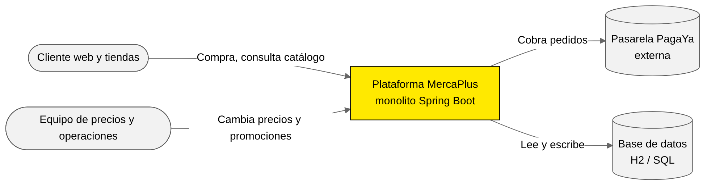
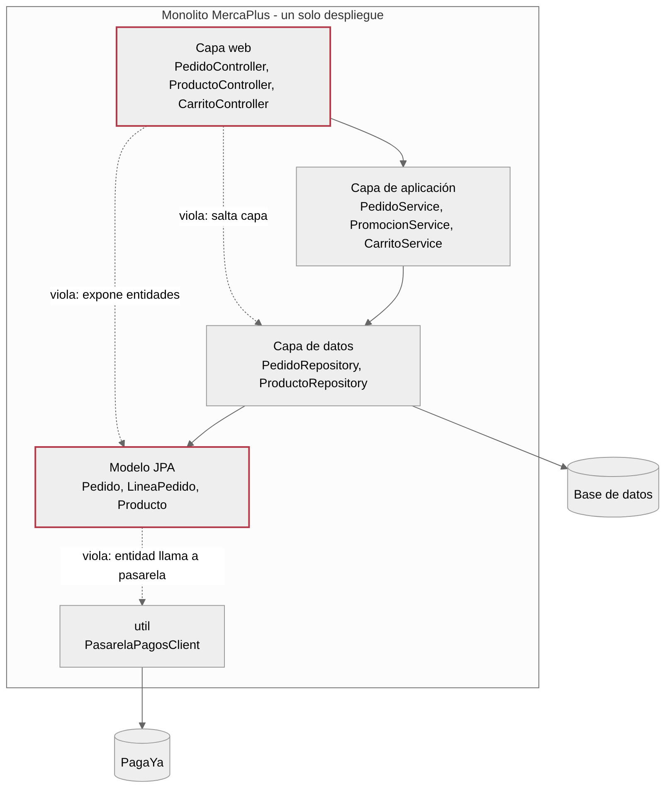
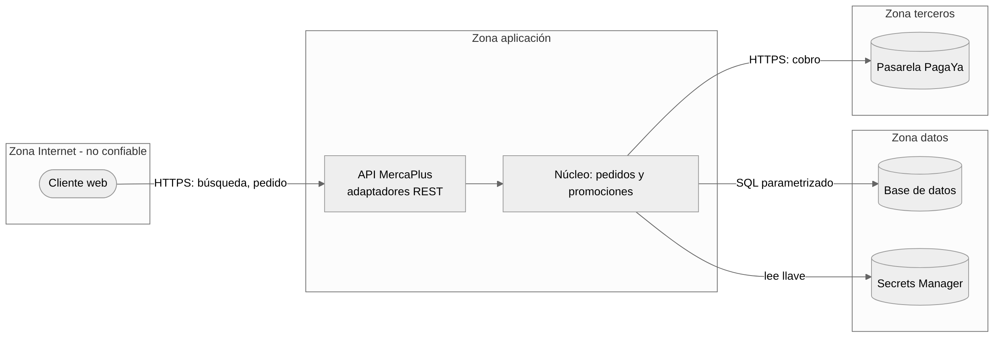
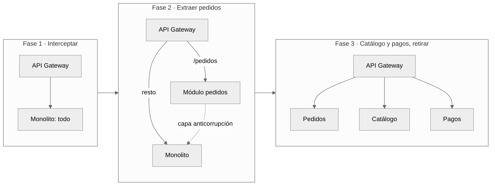
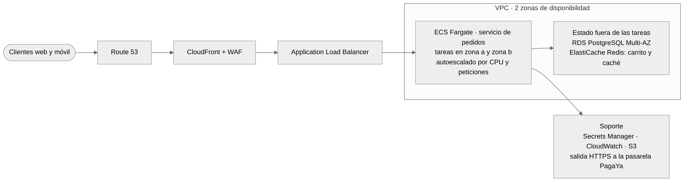

# Cómo usar este solucionario

Este documento trae la solución de referencia de los 8 laboratorios: lo que debe lograr la pista Build (código) y un modelo de respuesta para la pista Advise (consultoría). También trae los errores más frecuentes y cómo reconocer un trabajo sobresaliente.

- **El código resuelto** está en el repositorio `mercaplus-soluciones`. Este documento indica en qué archivo está cada solución. No se comparte con los estudiantes.
- **Los laboratorios son opcionales y no tienen nota.** En clase, el docente los demuestra en 15 a 20 minutos; el paso a paso de cada demostración está en la *Guía de laboratorios guiados*. Los estudiantes pueden hacerlos en casa y usar los criterios para autoevaluarse.
- **Los ADR modelo del Lab 6** están también como archivos en `docs/adr/` del repositorio de soluciones.
- **Los modelos de la pista Advise son una referencia, no la única respuesta válida.** Un equipo puede llegar a otras conclusiones si las justifica con evidencia del caso.
- **Las métricas de acoplamiento del Lab 2** se calcularon sobre el código real de los dos repositorios, contando las dependencias entre paquetes (`import`).

| Lab | Tema | Dónde está la solución de código |
|---|--------------|------------------------|
| 1 | Diagnóstico del monolito | `docs/hallazgos-docente.md` (16 hallazgos sembrados) |
| 2 | Puertos y adaptadores | `src/main/java/com/mercaplus/pedidos/**` |
| 3 | Kata TDD y mutación | `promociones/MotorPromociones.java` y su prueba; `service/PedidoServiceTest.java` |
| 4 | Seguridad por diseño | `controller/ProductoController.java`, `application.properties`, `ProductoControllerSeguridadTest.java` |
| 5 | Pipeline DevSecOps | `.github/workflows/ci.yml` |
| 6 | Deuda técnica, ADR, Strangler | No requiere código nuevo; ver ADR y registro en este documento |
| 7 | Escalado y AWS | `service/CarritoService.java` (Redis), `docker/docker-compose.yml`, `pom.xml` |
| 8 | Pitch | No requiere código; ver el modelo de pitch en este documento |

# Lab 1 · Diagnóstico del monolito legado

**Objetivo:** encontrar con evidencia dónde MercaPlus viola la arquitectura en capas que dice tener, y explicarlo al cliente.

## Pista Build: resultado esperado

Con `mvn test -Parquitectura -Dtest=ReglasArquitecturaTest` **fallan las 4 reglas**. Estas son las violaciones que el equipo debe registrar en `violaciones.md`:

| Regla | Clase origen → clase destino | Por qué es un problema |
|--------------|----------------|--------------------|
| `capas_respetadas` | `PedidoController` → `PedidoRepository` | La web se salta la capa de aplicación: la lógica de pedidos queda en el controlador |
| `capas_respetadas` | `PedidoController` → `ProductoRepository` | Ídem: el controlador descuenta stock directamente |
| `capas_respetadas` | `ProductoController` → `ProductoRepository` | La web accede a datos sin pasar por un servicio |
| `el_modelo_no_depende_de_infraestructura` | `Pedido` → `PasarelaPagosClient` | La entidad de negocio llama a la pasarela: no se puede probar sin ella y cambiar de proveedor toca el dominio |
| `los_controladores_no_usan_jpa` | `ProductoController` → `jakarta.persistence.EntityManager` | La web arma SQL a mano (además, es el origen de la inyección SQL del Lab 4) |
| `la_web_no_expone_entidades` | `PedidoController` → `Pedido`, `LineaPedido`, `Producto` | La API devuelve entidades JPA: cualquier cambio en una tabla rompe el contrato con los clientes |
| `la_web_no_expone_entidades` | `ProductoController` → `Producto` | Ídem |

**Recorrido de `POST /api/pedidos`** (todo ocurre en `PedidoController.crear`):

1. Recibe el JSON y crea la entidad `Pedido`, en la capa web.
2. Por cada ítem busca el producto en `ProductoRepository` y **valida el stock** en la capa web.
3. **Descuenta el inventario** y guarda el producto en la capa web.
4. Llama a `PromocionService.calcularDescuento`. Es la única regla que está en la capa de aplicación, y además tiene un error: el 2x1 se descuenta dos veces.
5. **Aplica el 5 % si el subtotal supera 300.000** en la capa web.
6. Llama a `pedido.pagar()`: la entidad **llama a la pasarela** de forma estática.
7. Guarda el pedido y devuelve la entidad.

Conclusión para el informe: de cinco reglas de negocio, cuatro viven en el controlador y una en la entidad. Ninguna se puede probar sin levantar la web, la base de datos y la pasarela.

## Pista Advise: modelo de respuesta

**C4 nivel 1 (contexto):** el sistema MercaPlus, los dos actores (clientes y el equipo de precios y operaciones) y los dos sistemas externos (la pasarela PagaYa y la base de datos).



**C4 nivel 2 (contenedores) con las violaciones marcadas.** Es aceptable dibujar las capas dentro del contenedor "monolito" para mostrar el problema, siempre que el equipo aclare que el despliegue es uno solo.



**Diagnóstico: 5 hallazgos priorizados (hallazgo → impacto → recomendación)**

1. **Las reglas de precios y descuentos están en la capa web.** → Cada cambio de promoción obliga a probar toda la aplicación, y por eso salir a producción toma 3 semanas. → Aislar las reglas en un núcleo de dominio con pruebas propias.
2. **La entidad Pedido llama directamente a la pasarela de pagos.** → Cambiar de proveedor o probar un pedido exige la pasarela real; el negocio pierde poder de negociación. → Definir un puerto de pagos y un adaptador por proveedor.
3. **La API devuelve las entidades de la base de datos.** → Un cambio en una tabla rompe la web y cualquier app que consuma la API. → Publicar DTO propios y versionar la API.
4. **El controlador de productos arma SQL a mano.** → Riesgo de seguridad (inyección) y acoplamiento a la base de datos. → Consultas parametrizadas en un adaptador de persistencia (se trabaja en el Lab 4).
5. **No hay pruebas que verifiquen reglas de negocio.** → El error del 2x1 llegó a producción sin ser detectado. → Pruebas unitarias del dominio (se trabaja en el Lab 3).

Prioridad: 1 y 2 primero, porque explican directamente la queja del CTO (precios que rompen el checkout) y el riesgo de Black Friday.

## Errores frecuentes

- Describir solo el problema técnico ("el controlador usa el repositorio") sin decir qué le cuesta al negocio.
- Dibujar el C4 nivel 1 con clases o capas: el nivel 1 solo muestra el sistema, las personas y los sistemas externos.
- Creer que la falla de las reglas ArchUnit es un error del laboratorio. Hay que aclararlo: las fallas son los hallazgos.

**Trabajo sobresaliente:** relaciona cada hallazgo con una frase del mensaje del CTO y propone un orden de trabajo para las 6 semanas que faltan para Black Friday.

# Lab 2 · Extraer "Crear pedido" a puertos y adaptadores

**Objetivo:** reconstruir el caso de uso como módulo hexagonal que convive con el monolito, y medir la mejora en acoplamiento.

## Pista Build: estructura de la solución

```text
com.mercaplus.pedidos
├── dominio
│   ├── Pedido.java
│   ├── LineaPedido.java
│   ├── EstadoPedido.java
│   └── PedidoInvalidoException.java
├── aplicacion
│   ├── CrearPedidoService.java
│   └── puerto
│       ├── entrada/CrearPedidoUseCase.java
│       └── salida/  CatalogoPort, PagosPort,
│                    PedidoRepositoryPort, PromocionesPort
└── infraestructura
    ├── rest/          PedidoRestController, ManejadorErrores
    ├── persistencia/  PedidoJpaAdapter, PedidoJpaEntity,
    │                  CatalogoLegadoAdapter
    ├── pagos/         PasarelaPagosAdapter
    ├── promociones/   MotorPromocionesAdapter
    └── config/        PedidosConfig
```

| Clase | Qué hace |
|---|---|
| `Pedido` | Agregado: `crear`, `registrarPago`, `rechazarPago`, `cancelar` |
| `LineaPedido` | Record inmutable con validación |
| `EstadoPedido` | CREADO, PAGADO, PAGO_RECHAZADO, CANCELADO |
| `CrearPedidoService` | Caso de uso, sin anotaciones de Spring |
| `PedidoRestController` | Ruta `/api/v2/pedidos`, con DTO propios |
| `PedidoJpaAdapter` | Persistencia en la tabla `pedido_v2` |
| `CatalogoLegadoAdapter` | Capa anticorrupción hacia el catálogo viejo |
| `MotorPromocionesAdapter` | Se conecta en el Lab 3 |
| `PedidosConfig` | Único lugar donde el núcleo se conecta con Spring |

Puntos que hay que verificar en la revisión:

- **El dominio no importa nada de Spring ni de JPA.** `Pedido` valida sus propias invariantes: al menos una línea, máximo 50 líneas, total entre 0 y el valor bruto, y no pagar dos veces.
- **`CrearPedidoService` recibe los cuatro puertos por constructor.** Solo reserva stock si el pago fue aprobado, y guarda el pedido también cuando el pago se rechaza.
- **`PedidosConfig` crea el caso de uso con `new`** y lo envuelve en un `TransactionTemplate`: la transacción es responsabilidad de la infraestructura.
- **`CatalogoLegadoAdapter` traduce la entidad `Producto` vieja** al record `ProductoCatalogo`, para que el modelo viejo no llegue al dominio.
- `mvn test -Parquitectura -Dtest=ReglasHexagonalesTest` queda en verde y `/api/pedidos` (el endpoint viejo) sigue funcionando.
- **Pruebas de referencia:** `CrearPedidoServiceTest` usa adaptadores en memoria (catálogo, pedidos y pagos falsos) y cubre pago aprobado, pago rechazado, producto inexistente y falta de stock.

## Pista Advise: métricas de acoplamiento

Valores reales, calculados contando las dependencias entre paquetes del código principal. I = Ce / (Ca + Ce).

**Antes (legado):**

| Paquete | Ca | Ce | I | Depende de |
|---|---|---|---|---|
| controller | 0 | 3 | 1,00 | model, repository, service |
| service | 1 | 2 | 0,67 | model, repository |
| repository | 2 | 1 | 0,33 | model |
| model | 3 | 1 | 0,25 | util |
| util | 1 | 0 | 0,00 | — |

**Después (módulo de pedidos):**

| Paquete | Ca | Ce | I | Depende de |
|---|---|---|---|---|
| pedidos.dominio | 4 | 0 | 0,00 | — |
| pedidos.aplicacion | 5 | 1 | 0,17 | dominio |
| infraestructura.pagos | 1 | 1 | 0,50 | aplicacion |
| infraestructura.promociones | 1 | 3 | 0,75 | aplicacion, dominio, promociones |
| infraestructura.rest | 0 | 2 | 1,00 | aplicacion, dominio |
| infraestructura.persistencia | 0 | 4 | 1,00 | aplicacion, dominio, model y repository viejos |
| infraestructura.config | 0 | 4 | 1,00 | aplicacion, pagos, promociones |

**Interpretación esperada:**

- En el legado, `model` es el paquete más estable (I = 0,25), pero es concreto y depende de `util`, es decir, de la pasarela. Eso viola SAP y explica por qué un cambio de proveedor llega hasta el dominio.
- En el módulo nuevo, el **dominio tiene I = 0** y no depende de nada. La aplicación es casi igual de estable y además expone interfaces (los puertos): cumple SDP y SAP.
- Todos los adaptadores tienen inestabilidad alta, y eso es correcto: son detalles reemplazables.
- La única dependencia del módulo nuevo hacia el monolito viejo está en `persistencia` (`CatalogoLegadoAdapter`), y está aislada en un solo adaptador. Es una dependencia temporal que se elimina en la fase 3 del Strangler Fig (Lab 6).
- **Cambiar de pasarela = un archivo nuevo en `infraestructura.pagos` y una línea en `PedidosConfig`.** Esa es la respuesta al gerente.

## Pista Advise: revisión con IA (ejemplo de registro)

| Sugerencia de la IA | Decisión | Razón |
|---|---|---|
| Mover la validación de stock al dominio | Aceptada en parte | La validación se hace en el caso de uso con datos del catálogo. El dominio valida sus propias invariantes, no conoce el stock |
| Agregar `@Service` a `CrearPedidoService` | Descartada | Rompe la independencia del framework; la composición se hace en `PedidosConfig` |
| Usar un `enum` para el estado en vez de `String` | Aceptada | Elimina estados inválidos (hallazgo 15) |
| Crear un microservicio de pagos | Descartada | Fuera de alcance; no hay plataforma ni equipo para operarlo (ver ADR 0002 en el Lab 6) |
| Hacer inmutable `LineaPedido` | Aceptada | Se implementa como `record` |

**Lista de chequeo, resultado esperado:** las 6 preguntas en "sí" para el módulo nuevo; en el legado, las 6 en "no".

## Errores frecuentes

- Anotar el dominio con `@Entity` "para ahorrar el mapeo". La regla de ArchUnit lo detecta.
- Puertos con nombres técnicos (`guardarFila`, `httpPost`) en vez de lenguaje de negocio.
- Borrar el endpoint viejo. Deben convivir.

**Trabajo sobresaliente:** demuestra con un cambio real (una rama nueva) que una segunda pasarela solo agrega un archivo.

# Lab 3 · Kata TDD de promociones y pruebas de mutación

**Objetivo:** construir con TDD el motor de promociones que reemplaza al que cobró el 2x1 dos veces, y demostrar que la cobertura no mide la calidad de las pruebas.

## Pista Build: solución de referencia

Archivo: `promociones/MotorPromociones.java`. Lógica final:

```java
public BigDecimal totalAPagar(List<Item> items, BigDecimal cupon) {
    BigDecimal bruto = BigDecimal.ZERO;
    BigDecimal ahorroPromos = BigDecimal.ZERO;
    for (Item item : items) {
        validar(item);                                  // regla 8
        BigDecimal valorItem = item.precioUnitario()
                .multiply(BigDecimal.valueOf(item.cantidad()));
        bruto = bruto.add(valorItem);                   // regla 1
        ahorroPromos = ahorroPromos
                .add(mejorAhorro(item, valorItem));     // reglas 2, 3 y 4
    }
    BigDecimal valorCupon = cupon == null
            ? BigDecimal.ZERO : cupon.max(BigDecimal.ZERO);
    BigDecimal ahorroTotal = ahorroPromos.add(valorCupon)   // regla 5
            .min(bruto.multiply(new BigDecimal("0.50")));   // regla 6
    return bruto.subtract(ahorroTotal).max(BigDecimal.ZERO)
            .setScale(0, RoundingMode.HALF_UP);             // regla 7
}

private BigDecimal mejorAhorro(Item item, BigDecimal valorItem) {
    BigDecimal ahorro2x1 = item.promo2x1()
            ? item.precioUnitario()
                  .multiply(BigDecimal.valueOf(item.cantidad() / 2))
            : BigDecimal.ZERO;
    BigDecimal ahorroCategoria = valorItem.multiply(
            descuentoPorCategoria.getOrDefault(item.categoria(), BigDecimal.ZERO));
    return ahorro2x1.max(ahorroCategoria);          // no acumulables
}
```

**Casos de verificación** (están en `MotorPromocionesTest`; se comprobaron con la ejecución de la lógica):

| Regla | Entrada | Total esperado |
|---|---|---|
| 1 | 2 × 21.500 + 1 × 249.000 | 292.000 |
| 2 | 2 cafés de 32.900 con 2x1 / 3 cafés / 1 café | 32.900 / 65.800 / 32.900 |
| 3 | TV de 2.199.000 con 20 % en TECNOLOGÍA | 1.759.200 |
| 4 | 2 audífonos de 189.900, 2x1 y 20 % | 189.900 (gana el 2x1) |
| 4 | 1 unidad de 100.000, 2x1 y 20 % | 80.000 (gana la categoría) |
| 5 | 100.000 con cupón de 20.000 | 80.000 |
| 5 y 6 | 50.000 con cupón de 80.000 | 25.000 (el tope del 50 % impide llegar a 0) |
| 6 | 2 × 50.000 con 2x1 y cupón de 20.000 | 50.000 |
| 7 | 10.000,5 | 10.001 |
| 8 | Cantidad 0 o precio negativo | `IllegalArgumentException` |

**Historial de commits esperado:** al menos un commit "verde" por regla y varios "refactor". El refactor típico aparece en la regla 4, cuando el equipo extrae `mejorAhorro` porque los descuentos dejan de sumarse.

**Pruebas del legado:** la versión con aserciones está en `service/PedidoServiceTest.java`. La cobertura de líneas de `PedidoService` no cambia, pero los mutantes de PIT pasan de sobrevivir casi todos a morir: se agregan los totales esperados (2.380.000 y 39.151), el estado `CANCELADO` y el caso de un pedido ya enviado que no se puede cancelar.

**Cierre de la pista:** `MotorPromocionesAdapter` implementa `PromocionesPort` y `PedidosConfig` lo registra con 20 % en TECNOLOGÍA. `CrearPedidoService` no cambia.

## Pista Advise: política de calidad de pruebas (modelo)

> **Política de calidad de pruebas de MercaPlus**
>
> 1. **Dominio y casos de uso:** prueba unitaria por cada regla de negocio, sin Spring ni base de datos, con adaptadores en memoria. Cobertura de líneas ≥ 80 % y puntaje de mutación ≥ 80 %.
> 2. **Adaptadores:** al menos una prueba de integración por adaptador contra su tecnología real (H2 o Testcontainers para persistencia, MockMvc para REST).
> 3. **Extremo a extremo:** solo los recorridos críticos (crear y pagar un pedido).
> 4. **Una prueba de mala calidad** es la que no tiene aserciones, verifica varios comportamientos a la vez, depende del orden o se llama `test1`.
> 5. **Los umbrales se verifican en el pipeline** (Lab 5) y no se bajan sin un ADR.

**Párrafo para el CFO (modelo):** "Las pruebas de MercaPlus pasaban por el 85 % del código, pero casi ninguna revisaba si el resultado era correcto: era como un auditor que firma todas las facturas sin leerlas. Por eso el 2x1 doble llegó a producción. Desde ahora medimos también si las pruebas detectan errores cuando cambiamos el código a propósito, y exigimos que detecten al menos 8 de cada 10."

## Errores frecuentes

- Escribir todas las pruebas primero y todo el código al final: eso no es TDD, y el historial lo muestra.
- Probar el motor con `@SpringBootTest`: es dominio puro y debe correr sin Spring.
- Confundir el tope de la regla 6 con el piso de la regla 5. El caso de 50.000 con cupón de 80.000 aclara el orden.

**Trabajo sobresaliente:** el equipo muestra un mutante que sobrevivió, explica qué comportamiento no estaba probado y agrega la prueba que lo mata.

# Lab 4 · Threat model STRIDE, validación en capas y mínimo privilegio

**Objetivo:** responder al auditor con un modelo de amenazas, la corrección demostrada de la inyección SQL y controles de mínimo privilegio.

## Pista Advise: diagrama de flujo de datos

Cuatro zonas de confianza: Internet (no confiable), aplicación, datos y terceros. Toda flecha que cruza una zona es un punto donde se aplica STRIDE.



## Pista Advise: tabla STRIDE (modelo con 10 amenazas)

Riesgo = probabilidad (1–3) × impacto (1–3).

| # | Amenaza | STRIDE | Riesgo (P×I) | Mitigación | Dueño |
|---|-------------------|-----|------|-------------------|---------|
| 1 | Inyección SQL en `/buscar` lee o modifica el catálogo | T, I | 9 (3×3) | Consulta parametrizada y validación con lista blanca | Desarrollo |
| 2 | Cambio de precios por API sin autenticación | T, E | 9 (3×3) | Retirar el endpoint; backoffice con autorización por rol | Arquitectura |
| 3 | Llave de PagaYa en el código y en logs | I, S | 9 (3×3) | Secrets Manager; no registrar secretos | DevSecOps |
| 4 | Aplicación conectada a la BD como administrador | E | 6 (2×3) | Usuario `mercaplus_app` con permisos mínimos | DevSecOps |
| 5 | Consola H2 expuesta a la red | E, I | 6 (2×3) | Deshabilitar la consola fuera de desarrollo | DevSecOps |
| 6 | Endpoints de actuator abiertos (variables de entorno, configuración) | I | 4 (2×2) | Exponer solo `health` e `info` | DevSecOps |
| 7 | Manipulación del total del pedido desde el cliente | T | 6 (2×3) | El total se calcula en el servidor; invariante en `Pedido.crear` | Desarrollo |
| 8 | Reintento de cobro duplica el pago | T | 4 (2×2) | Idempotencia con el `pedidoId` | Desarrollo |
| 9 | Pico de tráfico tumba el checkout | D | 6 (3×2) | Limitación de tasa, autoescalado (Lab 7) | Arquitectura |
| 10 | Cliente niega haber hecho un pedido | R | 2 (1×2) | Registro de auditoría con usuario, fecha y referencia de pago | Desarrollo |

Las amenazas 1 a 6 corresponden a los hallazgos del auditor. Un buen modelo también incluye amenazas que el auditor no mencionó (7 a 10).

## Pista Advise: política IAM y usuario de base de datos

```json
{
  "Version": "2012-10-17",
  "Statement": [
    {
      "Sid": "LeerSoloLaLlaveDePagaYa",
      "Effect": "Allow",
      "Action": "secretsmanager:GetSecretValue",
      "Resource": "arn:aws:secretsmanager:us-east-1:111122223333:secret:mercaplus/pagaya-api-key-*"
    },
    {
      "Sid": "EscribirSoloSusLogs",
      "Effect": "Allow",
      "Action": ["logs:CreateLogStream", "logs:PutLogEvents"],
      "Resource": "arn:aws:logs:us-east-1:111122223333:log-group:/ecs/pedidos:*"
    }
  ]
}
```

Cuenta y región de ejemplo. El sufijo `-*` es necesario porque Secrets Manager agrega caracteres aleatorios al ARN del secreto. La política va en el **rol de tarea** de ECS, no en el rol de ejecución.

```sql
-- db-usuario.sql (PostgreSQL)
CREATE ROLE mercaplus_app LOGIN PASSWORD :'pwd_desde_secrets_manager';
GRANT CONNECT ON DATABASE mercaplus TO mercaplus_app;
GRANT USAGE ON SCHEMA public TO mercaplus_app;
GRANT SELECT, INSERT, UPDATE
  ON producto, pedido, linea_pedido, pedido_v2, pedido_v2_linea
  TO mercaplus_app;
GRANT USAGE ON ALL SEQUENCES IN SCHEMA public TO mercaplus_app;
-- Sin DELETE, DROP, ALTER, TRUNCATE ni acceso a otros esquemas.
```

## Pista Build: solución

1. **Reproducir:** `GET /api/productos/buscar?nombre=' OR '1'='1` devuelve los 8 productos.
2. **Prueba primero:** `ProductoControllerSeguridadTest.inyeccionSqlEsRechazadaConError400` espera un 400 y que el repositorio nunca se invoque. Falla contra el código viejo.
3. **Corrección en `ProductoController`:** se elimina el `EntityManager` y la búsqueda usa `findTop50ByNombreContainingIgnoreCase`, una consulta derivada y parametrizada. El parámetro lleva `@NotBlank @Size(max = 50) @Pattern(regexp = "^[\\p{L}0-9 .,-]+$")`. Se retira `PUT /{id}/precio`.
4. **Validación en capas en `/api/v2/pedidos`:** el DTO valida la forma (`sku` con `^[A-Z0-9-]{3,20}$`, cantidad entre 1 y 100, máximo 50 ítems) y responde 400; el dominio valida las reglas y responde 422. La prueba `skuConCaracteresPeligrososEsRechazadoAntesDeLlegarAlNucleo` lo demuestra.
5. **Configuración** (`application.properties` de la solución): credenciales desde `${DB_URL}`, `${DB_USER}` y `${DB_PASSWORD}`; `spring.h2.console.enabled=false`; actuator solo con `health,info`; llave desde `${PAGAYA_API_KEY}`. `PasarelaPagosClient` ya no imprime la llave.

## Errores frecuentes

- Corregir la inyección escapando comillas a mano en vez de parametrizar.
- Validar las reglas de negocio con anotaciones en el DTO: la forma va en el adaptador, las reglas en el dominio.
- Usar `"Resource": "*"` "temporalmente" en la política IAM.
- Hacer el modelo de amenazas después del código: se pierde el propósito de la pista.

**Trabajo sobresaliente:** el modelo incluye amenazas no reportadas por el auditor, y cada mitigación tiene una prueba o una regla del pipeline que la vigila.

# Lab 5 · Pipeline DevSecOps con fitness functions

**Objetivo:** que ninguna violación de arquitectura, prueba fallida, dependencia vulnerable o secreto llegue a `main`.

## Pista Build: solución

La solución está en `.github/workflows/ci.yml` del repositorio de soluciones. Tiene dos jobs:

1. **`construir-y-probar`:** checkout; Java 21 con caché de Maven; `mvn -B verify`, que ejecuta las pruebas y el umbral de JaCoCo (80 % en el código nuevo de dominio, aplicación y promociones, según `pom.xml`); la fitness function `mvn -B test -Parquitectura -Dtest=ReglasHexagonalesTest`; y Trivy en modo `fs` con `scanners: vuln,secret`, `severity: CRITICAL,HIGH` y `exit-code: 1`.
2. **`imagen`** (depende del anterior): `docker build -f docker/Dockerfile` y Trivy en modo `image` con los mismos umbrales.

**Protección de la rama (Settings → Branches):** pull request obligatorio, al menos una aprobación y los dos jobs como verificaciones requeridas.

**Los dos pull requests que deben quedar bloqueados:**

| PR | Cambio | Etapa que lo bloquea | Mensaje esperado |
|--|------------------|----------|------------------|
| A | `import org.springframework.stereotype.Component;` en `pedidos/dominio/Pedido.java` | Fitness function (ArchUnit) | `Architecture Violation ... Rule 'no classes that reside in a package '..pedidos.dominio..' should depend on classes ...' was violated` |
| B | Agregar una llave con formato real de proveedor (por ejemplo una llave de acceso de AWS de prueba, `AKIA...`) | Trivy, escaneo de secretos | Trivy reporta el secreto y el job falla |

Nota: los escáneres de secretos reconocen patrones de proveedores conocidos. Una llave inventada como la de `PasarelaPagosClient` puede no detectarse. Si eso pasa, es una buena discusión: se agrega una regla personalizada en Trivy (o se usa gitleaks) y se discute por qué el escaneo automático no reemplaza a la revisión.

**GitOps (opcional):** un repositorio `mercaplus-gitops` con el manifiesto de despliegue. En `main`, el pipeline publica la imagen con el SHA del commit y abre un PR que actualiza el tag; Argo CD (o el despliegue de ECS) reconcilia. La autenticación con AWS se hace con OIDC, sin llaves guardadas en el repositorio.

## Pista Advise: diagnóstico de madurez (modelo)

**CALMS, de 1 a 5:**

| Dimensión | Nivel | Evidencia del caso |
|---|---|---|
| Cultura | 1 | Operaciones despliega el viernes por la noche; desarrollo no participa |
| Automatización | 1 | Despliegue manual; nadie sabía qué versión había en cada servidor |
| Lean | 2 | Lotes grandes: un despliegue al mes con muchos cambios juntos |
| Medición | 1 | Se supo del incidente por las quejas; no hay métricas de entrega |
| Compartir | 2 | No hay postmortem del incidente de 4 horas |

**DORA, situación actual y meta a 6 meses:**

| Métrica | Hoy (según el caso) | Meta a 6 meses |
|---|---|---|
| Frecuencia de despliegue | 1 al mes | Semanal, y luego bajo demanda |
| Lead time de cambios | ~3 semanas (mensaje del CTO, clase 1) | Menos de 1 semana |
| Tasa de fallo de cambios | Alta: el último despliegue tumbó el checkout | Menos del 15 % |
| Tiempo de recuperación | 4 horas | Menos de 1 hora, con reversión automática |

**Tres mejoras priorizadas:** (1) pipeline con verificaciones obligatorias y despliegue automatizado e idéntico en todos los nodos; (2) despliegue gradual con reversión automática y métricas del checkout en tiempo real; (3) postmortem sin culpables después de cada incidente.

**Párrafo para el cliente (modelo):** "DevOps es la forma de trabajar: desarrollo y operación entregan juntos, en pasos pequeños y automatizados. DevSecOps agrega la seguridad dentro de ese mismo flujo, de forma automática. GitOps es una forma de desplegar: lo que debe estar en producción se declara en Git, y un agente se encarga de que el entorno coincida."

## Errores frecuentes

- Poner la fitness function como un paso manual ("revisar que el dominio no use Spring").
- Configurar Trivy sin `exit-code: 1`: reporta, pero no bloquea.
- No proteger la rama: el pipeline falla, pero igual se puede hacer merge.

**Trabajo sobresaliente:** el equipo muestra el enlace a los dos PR rechazados y explica cuánto habría costado cada error si llegaba a producción.

# Lab 6 · Deuda técnica con SonarQube e IA, ADR y Strangler Fig

**Objetivo:** responderle al CFO cuánto cuesta la deuda, qué pagar primero y cómo migrar sin detener el negocio.

## Pista Build: qué deben encontrar

Los valores exactos de SonarQube dependen de la versión y del perfil de reglas; no se dan como respuesta fija. Lo que sí se espera:

- **En el legado:** al menos una vulnerabilidad o un *security hotspot* por el SQL concatenado, un secreto en el código (`PasarelaPagosClient`), `System.out.println`, código duplicado en `PromocionService` (las dos sumas del 2x1), redondeo inconsistente en `PedidoService` y cobertura baja.
- **En la versión actual:** menos deuda estimada (en tiempo), cero vulnerabilidades en el código nuevo y cobertura alta en dominio, aplicación y promociones.
- **Comparación con la IA:** la IA suele priorizar por cantidad de problemas; el equipo debe priorizar por **riesgo de negocio**. El SQL y el secreto van primero, aunque sean pocas líneas.

## ADR modelo

**ADR 0002 · Módulo hexagonal dentro del monolito antes que microservicio**

- Estado: aceptada.
- **Contexto:** el checkout cambia cada semana y falla en Black Friday. Un microservicio exige pipeline, observabilidad, red y un equipo de guardia que hoy no existen.
- **Opciones:** (a) microservicio de pedidos desde ya; (b) módulo hexagonal en el mismo despliegue, aislado con ArchUnit; (c) refactorizar el monolito sin módulos.
- **Decisión:** opción (b).
- **Consecuencias:** + cambios localizados y pruebas rápidas; + se puede extraer a un servicio más adelante sin reescribir el núcleo. − sigue escalando junto con el monolito; − mantener las reglas de ArchUnit es obligatorio para que no se vuelva a acoplar.

**ADR 0003 · Motor de promociones como librería de dominio**

- Estado: aceptada.
- **Contexto:** las reglas de promoción cambian en cada campaña y el error del 2x1 costó dinero.
- **Opciones:** (a) motor de reglas externo; (b) hoja de cálculo cargada en tiempo de ejecución; (c) clase de dominio pura, probada con TDD y expuesta por un puerto.
- **Decisión:** opción (c).
- **Consecuencias:** + pruebas en milisegundos con puntaje de mutación ≥ 80 %; + el caso de uso no conoce la implementación. − cada regla nueva requiere un despliegue; se acepta porque el pipeline (Lab 5) reduce ese costo.

## Pista Advise: registro de deuda técnica (modelo)

Principal = esfuerzo para pagarla. Interés = costo recurrente mientras exista. Impacto y esfuerzo, de 1 a 5.

| # | Ítem | Cuadrante de Fowler | Principal | Interés | Imp. | Esf. |
|---|------------------|------------|--------|------------------|-----|-----|
| 1 | Reglas de negocio en `PedidoController` | Deliberada, imprudente | 1 semana | Cada cambio de precio exige probar todo | 5 | 3 |
| 2 | Entidad `Pedido` llama a la pasarela | Deliberada, imprudente | 2 días | No se puede cambiar de proveedor | 5 | 2 |
| 3 | SQL concatenado en el buscador | Inadvertida, imprudente | 2 horas | Riesgo de fuga de datos | 5 | 1 |
| 4 | Secretos en el código y en logs | Deliberada, imprudente | 1 día | Riesgo de fraude con la pasarela | 5 | 1 |
| 5 | Pruebas sin aserciones | Inadvertida, imprudente | 3 días | Errores que llegan a producción (2x1) | 4 | 2 |
| 6 | Carrito en memoria de una réplica | Deliberada, prudente | 2 días | Impide escalar en Black Friday | 5 | 2 |
| 7 | API que expone entidades JPA | Deliberada, imprudente | 1 semana | Cada cambio de tabla rompe a los clientes | 3 | 3 |
| 8 | Estados como texto (`"PAGADO"`) | Inadvertida, prudente | 1 día | Estados inválidos posibles | 2 | 1 |
| 9 | Redondeo distinto según el monto | Inadvertida, imprudente | 2 horas | Diferencias contables | 3 | 1 |
| 10 | `System.out` en lugar de logs estructurados | Inadvertida, prudente | 1 día | Diagnóstico lento de incidentes | 2 | 1 |
| 11 | Despliegue manual sin verificación | Deliberada, imprudente | 1 semana | Incidentes como el del viernes | 5 | 3 |

**Matriz impacto × esfuerzo:** primero las ganancias rápidas (alto impacto y bajo esfuerzo): 3, 4, 2 y 6. Luego los proyectos grandes de alto impacto: 1, 11 y 7. Lo de bajo impacto (8, 9 y 10) se paga dentro del presupuesto regular.

**Presupuesto de deuda:** 20 % de la capacidad de cada sprint, y 40 % en las 6 semanas antes de Black Friday para los ítems 2, 3, 4 y 6.

## Pista Advise: hoja de ruta Strangler Fig



| Fase | Qué se hace | Enrutamiento | Criterio de salida |
|---|---|---|---|
| 1 · Interceptar | API Gateway delante del monolito, sin cambiar el comportamiento | 100 % al monolito | Gateway en producción 2 semanas sin errores nuevos |
| 2 · Extraer pedidos | `/api/v2/pedidos` atiende el tráfico nuevo; capa anticorrupción hacia el catálogo viejo | Pedidos al módulo nuevo (gradual: 10 %, 50 %, 100 %); el resto al monolito | Tráfico a `/api/pedidos` viejo en 0 durante 30 días y métricas de error iguales o mejores |
| 3 · Catálogo y pagos | Se extraen catálogo y pagos; se elimina `CatalogoLegadoAdapter` | Cada capacidad a su módulo | Monolito sin tráfico: se apaga y se borra el código |

## Errores frecuentes

- Un registro de deuda sin interés: solo lista problemas y no permite priorizar.
- Strangler Fig con "fase 2: reescribir todo".
- ADR que solo dice la decisión, sin contexto ni consecuencias negativas.

**Trabajo sobresaliente:** el equipo traduce el interés a días de desarrollo por trimestre y le muestra al CFO cuánto se recupera pagando los primeros 4 ítems.

# Lab 7 · Escalado horizontal y arquitectura objetivo en AWS

**Objetivo:** demostrar por qué "comprar un servidor más grande" no resuelve Black Friday, dejar el servicio sin estado y diseñar su destino en AWS.

## Pista Build: solución

1. `docker compose -f docker/docker-compose.yml up --build --scale app=3`. Varias llamadas a `GET /api/carrito/c-1` muestran distintos valores en el encabezado `X-Instancia`.
2. `k6 run k6/carga-black-friday.js`: **falla la verificación "carrito completo"**. Cada usuario agrega 3 productos, pero las peticiones caen en réplicas distintas y cada una tiene su propio `HashMap`. La tasa de éxito queda muy por debajo del 99 % del umbral.
3. **Corrección:**
    - En `pom.xml`, activar `spring-boot-starter-data-redis`.
    - En `CarritoService`, reemplazar el `ConcurrentHashMap` por `StringRedisTemplate`. Cada carrito es una lista en la clave `carrito:{clienteId}` con expiración de 2 días.
    - En `docker-compose.yml`, agregar el servicio `redis` y la variable `SPRING_DATA_REDIS_HOST: redis`.
    - La versión resuelta está en el repositorio de soluciones.
4. Repetir k6: la verificación pasa, porque todas las réplicas leen el mismo carrito.

**Tabla de resultados esperada (forma; los números los mide cada equipo):**

| Escenario | p95 (ms) | % verificación "carrito completo" | Errores |
|---|---|---|---|
| 1 réplica, carrito en memoria | Lo miden | ≈ 100 % (una sola memoria) | Lo miden |
| 3 réplicas, carrito en memoria | Lo miden | Muy bajo | Lo miden |
| 3 réplicas, carrito en Redis | Lo miden | ≈ 100 % | Lo miden |

La lectura correcta: con una réplica "funciona", pero no escala ni tolera fallos. Con tres y estado en memoria escala pero falla. Solo con el estado afuera se tienen las dos cosas.

## Pista Advise: estrategia 7 R (modelo)

| Componente | R | Justificación |
|---|---|---|
| Base de datos | Replataformar | A RDS PostgreSQL Multi-AZ: respaldos y alta disponibilidad administrados |
| Monolito (resto) | Rehospedar | A contenedores tal cual, como paso intermedio mientras dura el Strangler Fig |
| Módulo de pedidos | Refactorizar | Ya es hexagonal y probado: va a Fargate con autoescalado |
| Carrito | Refactorizar | De memoria a ElastiCache Redis: condición para escalar |
| Pasarela PagaYa | Retener | Es un servicio externo; solo cambia la red de salida |
| Reportes antiguos | Retirar | Si nadie los usa; validarlo con los registros de acceso |

## Pista Advise: arquitectura objetivo



Elementos que deben aparecer: Route 53, CloudFront con WAF, Application Load Balancer, ECS Fargate en **dos zonas de disponibilidad** con autoescalado, RDS Multi-AZ, ElastiCache Redis, Secrets Manager, CloudWatch y S3.

**Estimación de costos:** la hacen los equipos en AWS Pricing Calculator; los precios cambian, así que este solucionario no fija cifras. Una buena estimación tiene dos escenarios: operación normal (2 tareas mínimas) y semana de Black Friday (las tareas que hagan falta para 8 veces el tráfico), y explica que **solo cambian el número de tareas y el tamaño de la caché**. Revisen que el equipo no haya dejado servicios en regiones distintas ni haya olvidado el costo de transferencia de datos.

**Un riesgo y una mitigación por pilar (modelo):**

| Pilar | Riesgo | Mitigación |
|---|---|---|
| Excelencia operativa | Despliegues manuales | Pipeline del Lab 5 con despliegue automatizado |
| Seguridad | Secretos expuestos | Secrets Manager y rol de tarea con mínimo privilegio |
| Confiabilidad | Caída de una zona | Tareas y base de datos en dos zonas |
| Eficiencia de rendimiento | Base de datos saturada en el pico | Caché de catálogo y precios en Redis |
| Optimización de costos | Pagar el pico todo el año | Autoescalado con mínimos bajos y alertas de presupuesto |
| Sostenibilidad | Recursos encendidos sin uso | Apagar los entornos de prueba fuera de horario |

## Errores frecuentes

- Resolver el carrito con sesiones pegajosas en NGINX: la prueba pasa, pero no tolera la caída de una réplica.
- Una arquitectura con una sola zona de disponibilidad.
- Una sola R para todo el sistema.

**Trabajo sobresaliente:** el equipo apaga una réplica durante la prueba de k6 y demuestra que los carritos no se pierden.

# Lab 8 · Pitch de consultoría al comité de MercaPlus

**Objetivo:** integrar todo el módulo en una propuesta que la junta pueda aprobar.

## Modelo de las 5 diapositivas

1. **Diagnóstico.** Tres problemas que más cuestan: reglas de negocio acopladas a la web (3 semanas por cambio), pasarela atada al dominio (sin poder de negociación) y un sistema que no escala ni es seguro (Black Friday y el informe del auditor). Evidencia: reglas de ArchUnit, mutación casi nula y prueba de k6.
2. **Arquitectura objetivo.** El diagrama de AWS del Lab 7 con API Gateway como entrada única para la web, la app y el marketplace; un BFF para la app móvil; eventos para "pedido pagado" (facturación y despacho); Saga para pedido, pago e inventario; Circuit Breaker hacia la pasarela.
3. **Hoja de ruta.** Strangler Fig en 3 fases con criterios de salida (Lab 6), con un primer hito antes de Black Friday: los ítems de deuda 2, 3, 4 y 6.
4. **Riesgos.** Migración de datos (mitigación: sincronización y pruebas de reconciliación); equipo sin experiencia en la nube (mitigación: piloto con el módulo de pedidos); costo descontrolado (mitigación: alertas de presupuesto y autoescalado).
5. **Inversión y valor.** Costo AWS estimado en sus dos escenarios (Lab 7); metas DORA (Lab 5); equipos por dominio (pedidos, catálogo, pagos y un equipo de plataforma), según la maniobra inversa de Conway.

## Respuestas modelo a las preguntas de la junta

- **"¿Qué pasa si no hacemos nada?"** Cada cambio seguirá costando 5 semanas y subiendo; Black Friday volverá a tumbar el checkout, y el riesgo del informe del auditor sigue abierto.
- **"¿Por qué no microservicios desde ya?"** Porque no tenemos la plataforma ni los equipos para operarlos. El módulo hexagonal da la mayor parte del beneficio con mucho menos riesgo, y deja la puerta abierta (ADR 0002).
- **"¿Y la computación cuántica?"** Un experimento acotado con las rutas de entrega, como un adaptador más detrás del puerto "optimizador de rutas", medido contra la mejor solución clásica, que sigue en producción. El tema urgente es otro: planear la migración a criptografía post-cuántica.
- **"¿Qué equipo necesitamos?"** Equipos por dominio, dueños de su módulo de punta a punta, y un equipo de plataforma con el pipeline y AWS.

## Errores frecuentes

- Un pitch técnico, lleno de nombres de clases, frente a una junta de negocio.
- Prometer la computación cuántica como solución de producción.
- Que responda siempre la misma persona del equipo.

**Trabajo sobresaliente:** el equipo abre con el costo de no hacer nada, cierra con una decisión concreta que le pide a la junta y todos los integrantes responden con solvencia.
